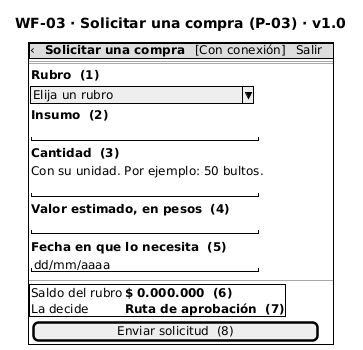
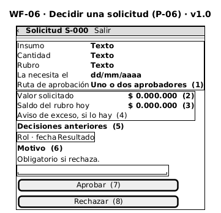
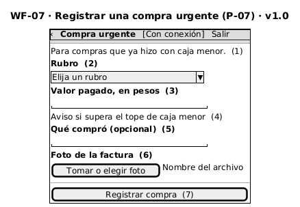
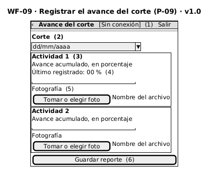

# Wireframes, mensajes y guía de estilo

| Campo | Valor |
|---|---|
| Versión | 1.0 · 2026-11-16 |
| Wireframes | En [`wireframes/`](wireframes/), escritos en PlantUML Salt para versionarlos como texto |

Un wireframe muestra qué hay en la pantalla y en qué orden, sin color ni tipografía. Se hicieron de las cuatro pantallas con más riesgo de uso: las tres que el residente llena en el frente de obra y la de decisión del aprobador. Las demás son listas y consultas.

## 1. Wireframes anotados

### WF-03 · Solicitar una compra (P-03)

| N.º | Elemento | Por qué está así | Requisito |
|---|---|---|---|
| 1 | Rubro, primero | De él dependen el saldo y la ruta. Lista cerrada: el rubro debe ser de la obra. | RF-002 |
| 2 | Insumo | Texto libre: no hay catálogo de insumos. | RF-001 |
| 3 | Cantidad con su unidad | Un solo campo para no obligar a elegir unidad de una lista. | RF-001, RNF-002 |
| 4 | Valor estimado | Teclado numérico y separador de miles mientras se escribe. | RF-001 |
| 5 | Fecha requerida | No admite fechas anteriores a hoy. | RF-002 |
| 6 | Saldo del rubro | Aparece al elegir rubro y valor; el residente ve el saldo, no el presupuesto. | RF-005, RN-16 |
| 7 | Quién la decide | El residente sabe a quién le llega antes de enviar. | RF-003 |
| 8 | Un solo botón | No hay «guardar borrador»: la solicitud se envía o no. | RNF-002 |

### WF-06 · Decidir una solicitud (P-06)

| N.º | Elemento | Por qué está así | Requisito |
|---|---|---|---|
| 1 | Ruta de aprobación | El aprobador ve si es el único o si falta otro. | RN-19 |
| 2 y 3 | Valor y saldo, juntos y en grande | Es la comparación que decide; nada más compite con ella. | RF-005 |
| 4 | Aviso de exceso | Solo si el valor supera el saldo. Informa; no bloquea. | RF-006 |
| 5 | Decisiones anteriores | En rutas de dos, el segundo ve qué decidió el primero. | RF-007, RF-042 |
| 6 | Motivo | Un solo campo; obligatorio solo al rechazar. | RF-009 |
| 7 y 8 | Aprobar y rechazar | Aprobar es la acción principal; rechazar va debajo y con otro estilo. | RF-007 |

### WF-07 · Registrar una compra urgente (P-07)

| N.º | Elemento | Por qué está así | Requisito |
|---|---|---|---|
| 1 | Frase inicial | Aclara que es para compras ya hechas, para que no se use en vez de la solicitud. | RN-07 |
| 2 | Rubro | Obligatorio: sin él no hay saldo que descontar. | RF-013 |
| 3 | Valor pagado | Teclado numérico y separador de miles. | RF-012 |
| 4 | Aviso de tope | Si supera el tope de caja menor, avisa y deja registrar. | RN-09 |
| 5 | Qué compró | Opcional, para no frenar el registro. | RNF-002 |
| 6 | Foto de la factura | Abre la cámara del celular. Obligatoria. | RF-013, RN-08 |
| 7 | Registrar | El saldo resultante se muestra en la confirmación. | RF-012 |

### WF-09 · Registrar el avance del corte (P-09)

| N.º | Elemento | Por qué está así | Requisito |
|---|---|---|---|
| 1 | Estado de la conexión | Siempre visible para el residente. | RF-024 |
| 2 | Corte | Viene elegido el corte vigente. | RF-023 |
| 3 | Un bloque por actividad | Todas en una sola pantalla: se recorre de arriba abajo sin navegar. | RNF-001 |
| 4 | Último avance registrado | Referencia para no digitar un valor menor por error. | RN-13 |
| 5 | Fotografía por actividad | Abre la cámara. Obligatoria. | RF-023 |
| 6 | Guardar | Sin conexión guarda en el dispositivo y lo dice. | RF-024, RF-025 |

## 2. Los cuatro estados de cada pantalla

| Pantalla | Vacío | Cargando | Error | Éxito |
|---|---|---|---|---|
| P-03 Solicitar una compra | Formulario en blanco; saldo y ruta ocultos hasta elegir rubro y valor | «Guardando…» | Mensaje junto a cada campo; el foco va al primero ([captura](pantallas/p-03-solicitud-error.png)) | Pasa a P-04 con OK-01 |
| P-04 Mis registros | V-01 | — | ERR-13 al anular sin motivo | OK-06 |
| P-05 Por decidir | V-02 ([captura](pantallas/p-05-por-decidir-vacio.png)) | — | — | Aviso de la decisión tomada |
| P-06 Decidir una solicitud | Motivo en blanco | «Guardando…» | ERR-13 al rechazar sin motivo; ERR-11 y ERR-12 si no le corresponde | OK-02, OK-03, OK-04 u OK-05 |
| P-07 Compra urgente | Formulario en blanco | «Guardando…» | ERR-01, ERR-04, ERR-07 junto al campo | Pasa a P-04 con OK-07 |
| P-08 Legalizar | Observación en blanco | «Guardando…» | ERR-13 al devolver sin observación | OK-08 u OK-09 |
| P-09 Avance del corte | Porcentajes en blanco con el último valor como referencia | «Guardando…» | ERR-08, ERR-09 por actividad; ERR-14 en el corte ([captura](pantallas/p-09-avance-error.png)) | OK-10, o A-04 si no hay conexión |
| P-10 Presupuesto | Rubros sin gasto muestran 0 % | — | — | — |
| P-11 Avance de la obra | V-03 | — | ERR-13 al devolver sin motivo | OK-11 |

El estado «cargando» se ve en la [captura](pantallas/p-03-solicitud-cargando.png).

## 3. Catálogo de mensajes

Reglas de redacción: una frase, en segunda persona formal, dice qué hacer y no qué falló; sin códigos ni términos técnicos. El texto vive en `app/mensajes.js`; esta tabla se genera de ese archivo.

<!--MENSAJES-->
| Código | Tipo | Texto |
|---|---|---|
| ERR-01 | Error | Elija el rubro de la compra. |
| ERR-02 | Error | Escriba el insumo que necesita. |
| ERR-03 | Error | Escriba la cantidad. |
| ERR-04 | Error | Escriba un valor mayor que cero. |
| ERR-05 | Error | Elija la fecha en que necesita el insumo. |
| ERR-06 | Error | La fecha requerida no puede ser anterior a hoy. |
| ERR-07 | Error | Adjunte la foto de la factura. |
| ERR-08 | Error | El avance debe estar entre 0 y 100. |
| ERR-09 | Error | Agregue una fotografía del avance. |
| ERR-10 | Error | Este registro ya no admite cambios. |
| ERR-11 | Error | No puede decidir una solicitud que usted registró. |
| ERR-12 | Error | Esta acción le corresponde a otra persona. |
| ERR-13 | Error | Escriba el motivo. |
| ERR-14 | Error | Este corte ya tiene un reporte registrado. |
| OK-01 | Éxito | Solicitud {id} registrada. La decide: {ruta}. |
| OK-02 | Éxito | Solicitud {id} aprobada. Saldo del rubro: {saldo}. |
| OK-03 | Éxito | Aprobación registrada. Falta la decisión de: {rol}. |
| OK-04 | Éxito | Solicitud {id} rechazada. |
| OK-05 | Éxito | El saldo del rubro cambió y con él la ruta. Ahora la decide: {ruta}. |
| OK-06 | Éxito | Solicitud {id} anulada. |
| OK-07 | Éxito | Compra urgente {id} registrada. Saldo del rubro: {saldo}. |
| OK-08 | Éxito | Compra {id} legalizada. |
| OK-09 | Éxito | Compra {id} devuelta al residente con su observación. |
| OK-10 | Éxito | Reporte del corte {corte} registrado. |
| OK-11 | Éxito | Reporte del corte {corte} devuelto al residente. |
| OK-12 | Éxito | Se recuperó la conexión: {n} reporte enviado. |
| A-01 | Aviso | El rubro {rubro} llegó al {p} % de su presupuesto. |
| A-02 | Aviso | Esta compra supera el tope de caja menor. |
| A-03 | Aviso | El valor supera el saldo del rubro en {exceso}. |
| A-04 | Aviso | Sin conexión. El reporte quedó guardado en este dispositivo y se enviará solo. |
| V-01 | Lista vacía | Todavía no tiene registros. |
| V-02 | Lista vacía | No hay nada pendiente por decidir. |
| V-03 | Lista vacía | Aún no hay reportes de avance. |

## 4. Guía de estilo mínima

Definida como variables en `app/estilos.css`.

### Color y contraste

Contraste medido con la fórmula de WCAG 2.2. Mínimo: 4,5:1 para texto y 3:1 para bordes y foco.

| Uso | Colores | Contraste |
|---|---|---|
| Texto sobre fondo | `#1b1f24` sobre `#f4f5f7` | 15,2:1 |
| Texto secundario sobre fondo | `#4a5360` sobre `#f4f5f7` | 7,1:1 |
| Texto blanco sobre el color primario | `#ffffff` sobre `#0b5cab` | 6,7:1 |
| Color primario sobre tarjeta | `#0b5cab` sobre `#ffffff` | 6,7:1 |
| Error sobre fondo | `#a4262c` sobre `#f4f5f7` | 6,7:1 |
| Éxito sobre su fondo | `#1a6b3c` sobre `#e3f3e9` | 5,7:1 |
| Error sobre su fondo | `#a4262c` sobre `#fbe9ea` | 6,2:1 |
| Alerta sobre su fondo | `#7a4b00` sobre `#fff4d6` | 6,8:1 |
| Borde de campo sobre tarjeta | `#6b7480` sobre `#ffffff` | 4,7:1 |
| Foco sobre fondo | `#1b1f24` sobre `#f4f5f7` | 15,2:1 |
| Foco sobre la barra | `#ffffff` sobre `#0b5cab` | 6,7:1 |

El color nunca es la única señal: cada estado lleva su nombre escrito y cada error su texto.

### Tipografía, tamaños y espacios

| Elemento | Valor |
|---|---|
| Fuente | La del sistema del dispositivo |
| Texto base | 16 px; interlineado 1,45 |
| Título de pantalla | 20 px |
| Cifra destacada (valor y saldo) | 21,6 px, en negrita |
| Alto mínimo de botones y campos | 44 px; botones principales, 48 px |
| Ancho máximo del contenido | 640 px, centrado |
| Radio de esquinas | 8 px |
| Espacio base | 8 px y sus múltiplos |

### Componentes

| Componente | Regla |
|---|---|
| Botón principal | Uno por pantalla, de ancho completo, fondo primario |
| Botón secundario o de riesgo | Fondo blanco con borde; rojo si anula o rechaza |
| Campo | Etiqueta arriba, ayuda debajo de la etiqueta, error debajo del campo |
| Estado | Etiqueta con su nombre: ámbar si espera una acción, verde si terminó bien, rojo si terminó sin efecto |
| Aviso | Arriba del contenido; verde, rojo o ámbar; lo anuncia el lector de pantalla |
| Tarjeta | Agrupa los datos de un registro; dato a la izquierda, valor a la derecha |
